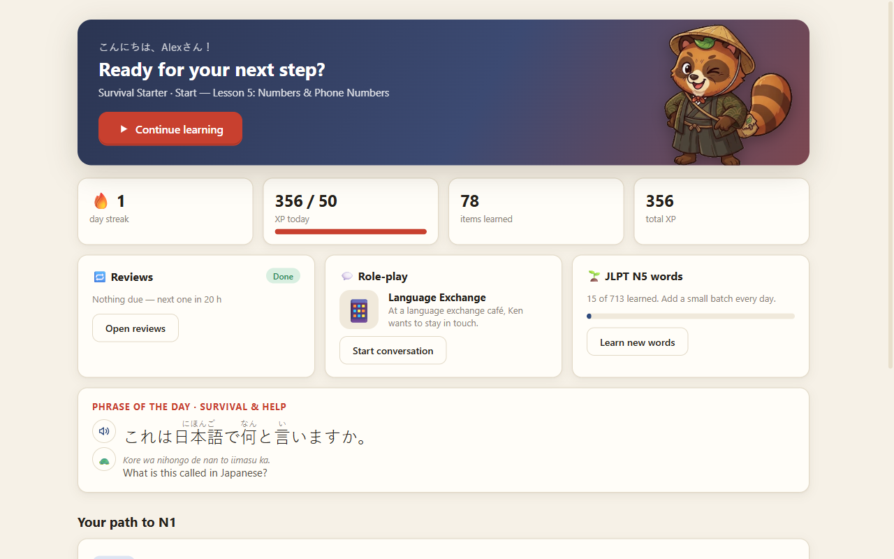
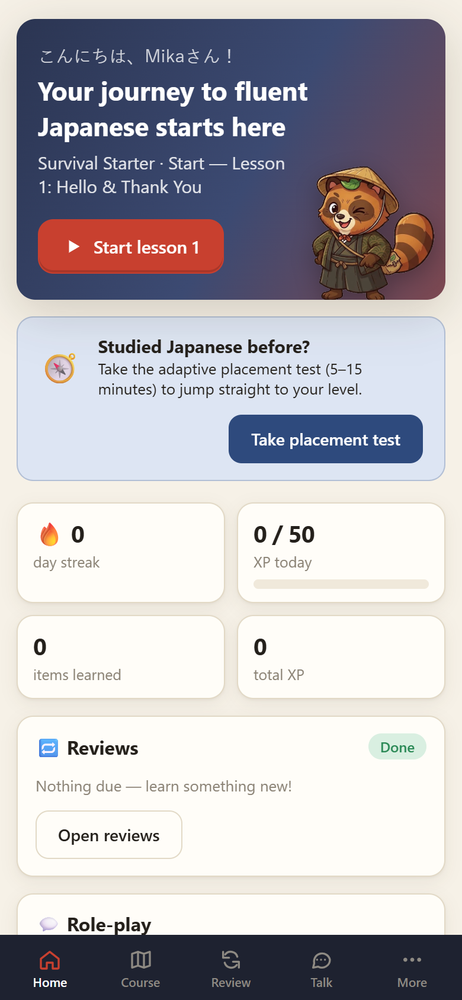
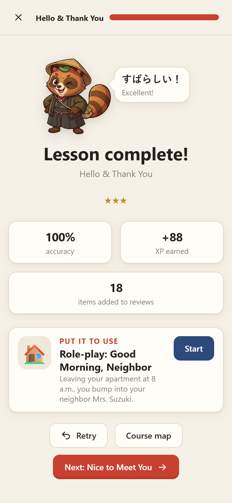
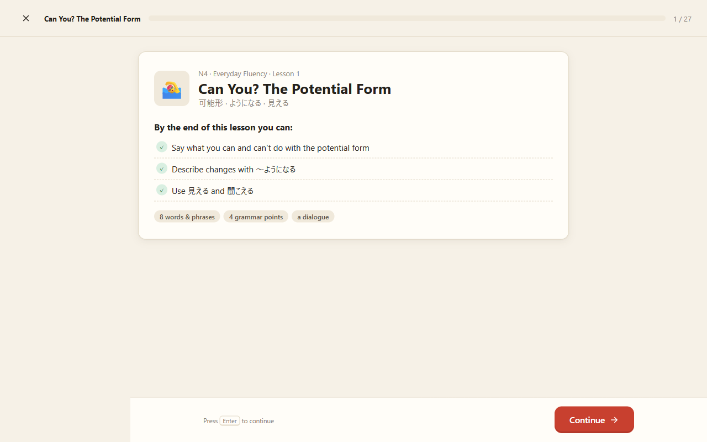
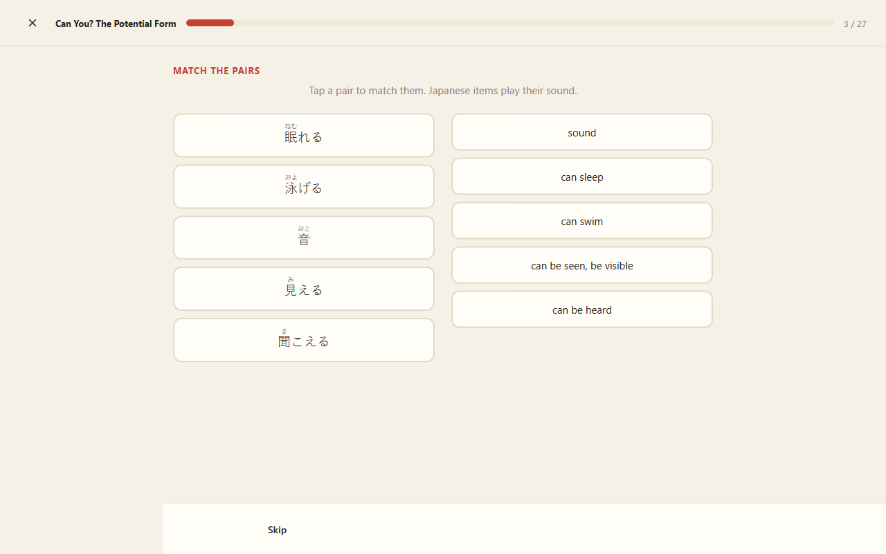
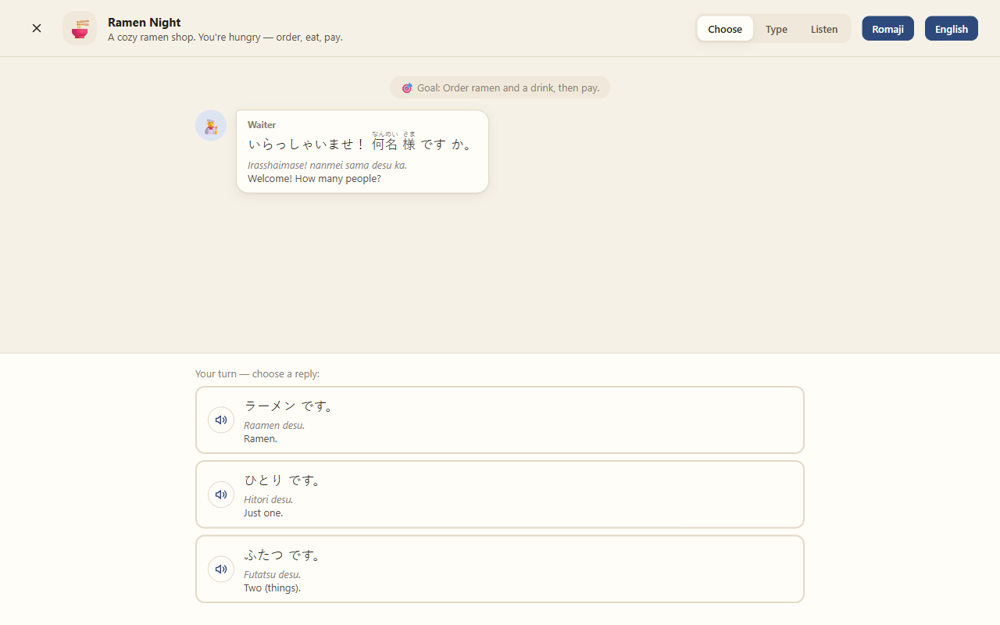
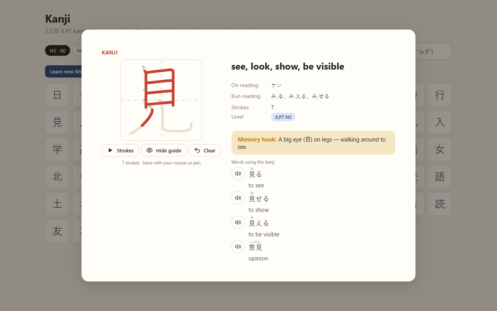

# Nihongo Michi 日本語の道


A free app for Windows, iPhone and Android that teaches Japanese from zero to JLPT N1, with the
emphasis on real-world, conversational Japanese. You start by surviving a trip to Japan (ordering
ramen, asking for directions, paying) and work up through the JLPT levels with grammar, reading,
kanji and plenty of role-play conversations along the way.

Your guide on the road (*michi*) is **Tabi** (旅, "journey"), a travelling tanuki with a straw hat and
the leaf tanuki use for their shape-shifting tricks.



## Download

Get the latest `.zip` from the [Releases page](https://github.com/RickUsingGitHub/nihongo-michi/releases),
unzip it anywhere and run **Nihongo Michi.exe**. There's nothing to install.

- **Windows 10 or 11, 64-bit.**
- **Japanese voice (free, built into Windows):** Settings → Time & language → Speech → *Add voices* →
  Japanese. The app's Settings → Audio page links straight there. Without it everything works except speech.
- **SmartScreen:** the exe isn't code-signed, so Windows may say it "protected your PC". Choose
  *More info* → *Run anyway*.

Progress is saved per learner in `%APPDATA%\Nihongo Michi\profiles`, so several people can share one PC.

Nihongo Michi is free — no ads, no account. If it is helping you learn, you can [buy me a coffee](https://ko-fi.com/rickapps).

## On your phone

Open **<https://rickusinggithub.github.io/nihongo-michi/>** on your iPhone or Android phone and add it to your
home screen. It then opens full screen like an app and works offline.

- **iPhone (Safari):** tap Share ⬆ → *Add to Home Screen*.
- **Android (Chrome):** tap *Install app* in the app, or the ⋮ menu → *Install app*.
- **Japanese voice:** iPhones: Settings → Accessibility → Spoken Content → Voices → Japanese. Android: Settings →
  Languages & input → Text-to-speech → install Japanese voice data.

<p>
  
  &nbsp;
  
</p>

## Syncing between PC and phone

Each learner can connect their own Google account under **Settings → Sync**. Progress is then kept in a private
app folder in that learner's Google Drive that only Nihongo Michi can see, and it syncs automatically while they
study. On a new device, choose **Continue with Google** on the "Who's learning today?" screen to bring a learner over.

Practice done on both devices adds up: lessons and tests keep the best result, each review item keeps its most
recent review, and XP and streaks count every device. Sync is optional; without it everything stays on the device.
See [docs/google-setup.md](docs/google-setup.md) for the one-time Google Cloud setup, and [privacy](src/privacy.html).

## What's inside

| | |
|---|---|
| **Course** | 123 lessons in 10 levels: a Survival Starter, five N5 units, then N4, N3, N2 and N1 |
| **Grammar** | 420 grammar points, each with examples, notes on usage and drills |
| **Conversation** | 75 branching role-plays (restaurant, hotel, doctor, job interview, …) in choose, type or listen mode, plus a dialogue in every lesson |
| **Kana** | Hiragana and katakana from the first lesson, with charts, drills and listening |
| **Kanji** | All 2,230 JLPT kanji with readings, example words and animated stroke order you can trace; memory hooks for the kanji taught in lessons |
| **Vocabulary** | About 8,000 JLPT words in level decks, plus a 126-phrase phrasebook and a searchable dictionary |
| **Practice** | Spaced-repetition reviews, listening at normal or slow speed, typing in romaji (converted to kana as you type), word-order puzzles, record-and-compare shadowing |
| **Tests** | An adaptive placement test so returning learners can jump ahead, level tests and JLPT-style mock exams |
| **Learners** | Separate profiles with their own progress, XP and streaks; light and dark themes |

| | |
|---|---|
|  |  |
|  |  |

## Status

The app works end to end and its lessons, role-plays, reviews and tests are covered by automated
checks. The course content was written with AI assistance and **has not yet been reviewed by a
native speaker**. If you spot unnatural Japanese, a wrong reading or a bad translation, please
[open an issue](https://github.com/RickUsingGitHub/nihongo-michi/issues).

Speech uses the Windows Japanese voices. They occasionally misread kanji (音 as "on" instead of
"oto"), so the app gives the voice the course reading for the ~600 words it was found to misread.

## Building from source

Requires [Node.js](https://nodejs.org) 22.12 or later.

```bash
npm install
npm start
```

To build the Windows app into `dist/`:

```bash
npm run package
```

The phone version is the same `src/` folder served as a website. To try it locally, serve `src/`
(for example `python -m http.server 8765 --directory src`) and open <http://localhost:8765>. After changing
anything in `src/`, run `node tools/build-web.js` to refresh the offline cache list (`src/sw.js`).
Pushing to `main` publishes it to GitHub Pages (`.github/workflows/pages.yml`).

### Project layout

```
main.js, preload.js   Electron main process: window, learner profiles on disk, speech helper, Google sign-in
tts/tts.ps1           Text-to-speech through the Windows OneCore voices (PowerShell + WinRT)
src/index.html        The app (plain HTML/CSS/JS, no framework or build step); also the phone web app
src/lib/              Kana/romaji, furigana markup, storage, spaced repetition, audio, Google sign-in, Drive sync
src/app/              Views: lessons, exercises, role-plays, reviews, placement, library, settings
src/data/             Course content (course*.js, convos*.js, phrasebook, placement questions)
src/data/gen/         Word, kanji and stroke data generated from tools/raw
tools/                Data build and content checks
```

Course text uses a small furigana markup: `私[わたし] は 学生[がくせい] です。` (spaces separate
words, `*…*` marks the grammar point in an example).

### Checks

```bash
node tools/validate.js     # content: readings, exercises, references
node tools/test-lib.js     # kana, romaji and markup library
node tools/test-sync.js    # syncing a PC and a phone through a simulated Google Drive
node tools/tts-check.js    # speech text for everything the app can say
```

After changing course content, regenerate the list of words the voices misread (about 7 minutes,
nothing is played aloud):

```bash
node tools/tts-check.js --speak --write --voice ayumi
node tools/tts-check.js --speak --write --merge --voice haruka
node tools/tts-check.js --speak --write --merge --voice ichiro
```

`node tools/build-data.js` rebuilds `src/data/gen/` from the datasets in `tools/raw/`.

## Credits and licence

The code and the original course content are released under the [MIT licence](LICENSE).

The app bundles open data: JLPT word lists by Jonathan Waller (CC BY), English meanings from
JMdict and kanji data from KANJIDIC (both © EDRDG, CC BY-SA 4.0), and stroke order from KanjiVG
© Ulrich Apel (CC BY-SA 3.0). Those datasets keep their own licences, as listed in
[THIRD-PARTY-NOTICES.md](THIRD-PARTY-NOTICES.md).

JLPT level assignments are unofficial: the JLPT has not published official lists since 2010.
